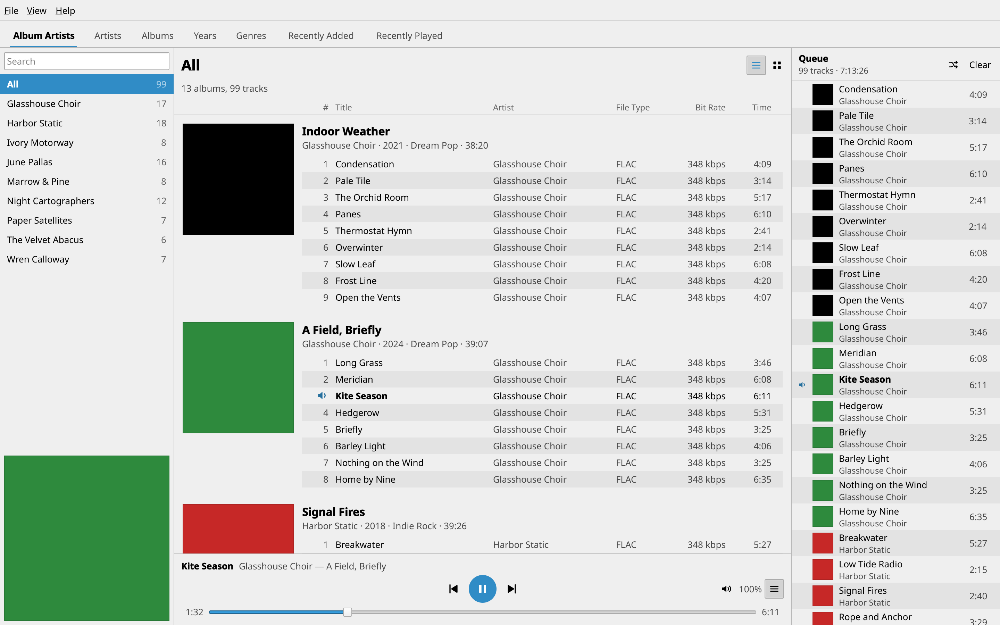

I wanted a music player that mixed a few music players I liked to use on Windows, Linux, and Mac. 
I wanted to create something simple without any tag editing and focuses solely on playing music. 
I am also not huge on playlists, so that isn't going to be in the initial version. However, I might add this functionality later if someone else wants it. 

My inspirations for this project:
* MusicBee
* Google Play Music
* Apple Music
* Foobar2k

<picture>
  <source media="(prefers-color-scheme: dark)" srcset="docs/screenshots/dark.png" />
  
</picture>
